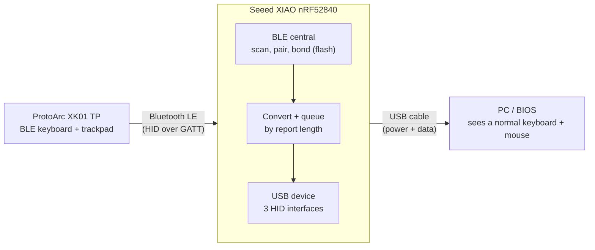
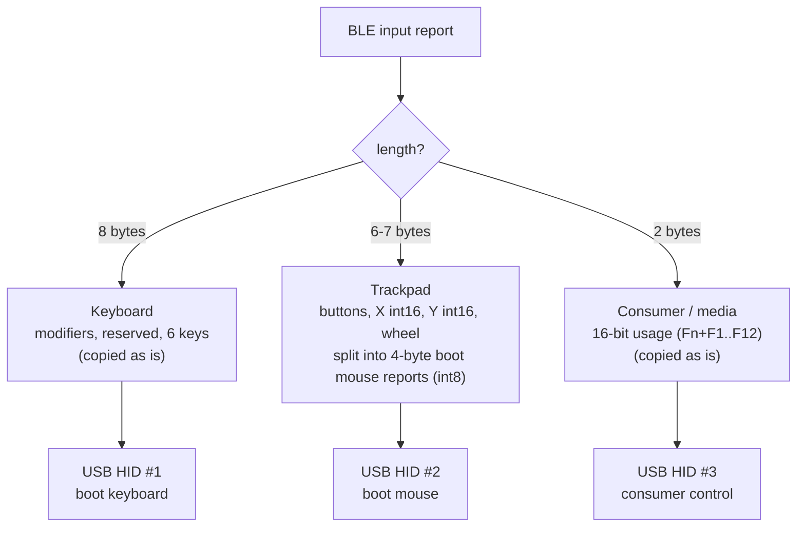
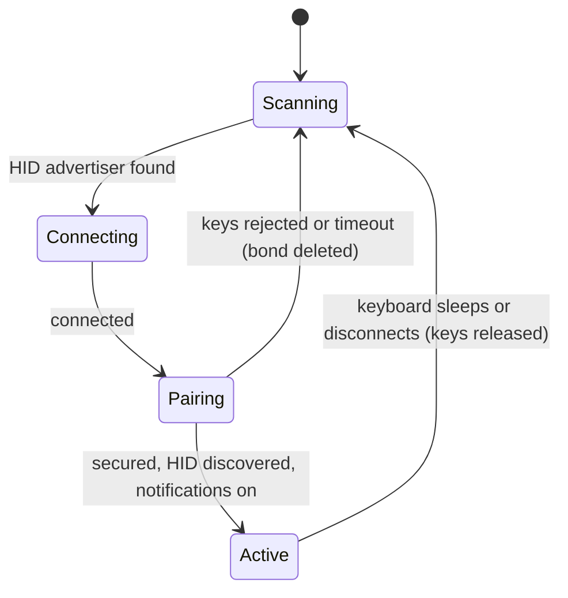

# btbridge

**Bluetooth keyboard + trackpad → plain wired USB keyboard + mouse**, on a ~€10 microcontroller.
No drivers, no Bluetooth stack and no Linux needed on the PC: it just sees a standard USB keyboard and mouse
(BIOS/UEFI, old Linux, Windows, ...).

Built for the **ProtoArc XK01 TP** (BLE keyboard with built-in trackpad) and the **Seeed XIAO nRF52840 (Sense)**.
It replaces an earlier Raspberry Pi Zero 2W version (still in [`pi/`](pi/)), which worked but booted slowly.

## How it works



1. The board scans for BLE devices advertising the HID service and connects to the keyboard.
2. It pairs (Just Works), stores the bond in flash and subscribes to every input *Report* characteristic.
3. Each notification is classified by its length and converted:



The keyboard has no *boot mouse* characteristic, so the trackpad is only available in the HID *report protocol*.
The bridge reads those reports and re-emits them as classic **boot-protocol** reports, which every BIOS and kernel understands.

### USB layout

| Interface | Function | Notes |
|---|---|---|
| 0, 1 | CDC serial | debug only (Serial Monitor) |
| 2 | HID keyboard | boot class, 8-byte report, LED output report |
| 3 | HID mouse | boot class, 4-byte report (buttons, X, Y, wheel) |
| 4 | HID consumer | 16-bit usage: volume, brightness, media keys |

### Connection lifecycle



If the keyboard was re-paired (for example you put its channel in pairing mode again) the stored keys no longer
match: the bridge deletes that bond and pairs again by itself.

## Status LED

A short flash every 2 s shows the state; a second, **long** flash (0.5 s) shows the last error.

| Colour | State (short flash) | Colour | Last error (long flash) |
|---|---|---|---|
| Blue | scanning | Red | HID service not found |
| Yellow | keyboard found | Magenta | keyboard closed the link |
| Cyan | connected, pairing | White | closed by the bridge |
| Green | secured and active | Green / Yellow / Blue | timeout / connect failed / other |
| | | Cyan | stale bond deleted, retrying |

While you type: solid **blue** = keyboard report received, **magenta** = trackpad, **red** = report received but USB not ready.

## Hardware

* Seeed **XIAO nRF52840** (Sense or plain). Other nRF52840 boards with the Adafruit/Seeed bootloader should work with minor changes.
* A BLE HID keyboard. The report layout was read from the ProtoArc XK01 TP with [`firmware/probe`](firmware/probe/probe.ino);
  other keyboards may need the report lengths adjusted in `onReport()`.

## Setup (one time)

1. Clone the repo and install [`arduino-cli`](https://arduino.github.io/arduino-cli/) (or the Arduino IDE 2.x).
2. Install the board core **Seeed nRF52 Boards** (`Seeeduino:nrf52`), version **1.1.13** (the one this was tested with):

   ```bash
   arduino-cli config init
   arduino-cli config add board_manager.additional_urls https://files.seeedstudio.com/arduino/package_seeeduino_boards_index.json
   arduino-cli core update-index
   arduino-cli core install Seeeduino:nrf52@1.1.13
   ```

   In the Arduino IDE: Preferences → Additional boards manager URLs → same URL, then Boards Manager → "Seeed nRF52 Boards" 1.1.13.
3. **No other library is needed.** Bluefruit (BLE) ships with the core, and the patched TinyUSB is in `firmware/lib`.
   Do not install the Adafruit TinyUSB library from the Library Manager: it would shadow the patched one.
4. Linux/macOS only (not tested by the author): the board appears as a serial port (`/dev/ttyACM*`, `/dev/cu.usbmodem*`) instead
   of `COMx`. On Linux your user usually needs the `dialout` group to flash.

## Build and flash

Use the commands below from the `firmware/` folder; replace `COMx` with the bootloader port (double-tap RESET to enter it:
the board then shows up as a new serial port, and the LED pulses).

```bash
# from firmware/
arduino-cli compile --fqbn Seeeduino:nrf52:xiaonRF52840:softdevice=s140v6,debug=l0 \
  --library lib/Adafruit_TinyUSB_Arduino --output-dir btbridge/build btbridge
# double-tap RESET on the board (bootloader, new COM port), close the Arduino IDE, then:
arduino-cli upload -p COMx --fqbn Seeeduino:nrf52:xiaonRF52840:softdevice=s140v6,debug=l0 --input-dir btbridge/build
```

* `--library lib/Adafruit_TinyUSB_Arduino` is **required**: the stock library supports only one HID interface
  (`CFG_TUD_HID` = 1 and a single-instance HID wrapper). What was changed, why, and in which three files is documented in
  [`firmware/lib/PATCHES.md`](firmware/lib/PATCHES.md).
* Close the Arduino IDE (and any serial monitor) before uploading: it holds the port.
* In the Arduino IDE, copy `firmware/lib/Adafruit_TinyUSB_Arduino` into your sketchbook `libraries/` folder
  (remove or rename any other copy), open `firmware/btbridge/btbridge.ino`, and select board **Seeed XIAO nRF52840** with
  SoftDevice **S140 7.3.0** and Debug **Level 0 (Release)**. The IDE does not accept `--library`, so the local copy is what makes it work.
* After flashing the board restarts as `btbridge` (serial port, about 5-10 s later).
* `softdevice=s140v6` is the menu entry "S140 7.3.0"; the board must run bootloader 0.6.2 with SoftDevice 7.3.0.

### Pairing

Put the keyboard channel in pairing mode and power the bridge: it connects by itself (green flashes).
Each keyboard channel is paired once; afterwards it reconnects when the keyboard wakes (reconnect without pairing mode is still to be verified).
If you re-pair a channel, the bridge discards its stale bond and pairs again automatically (cyan long flash).

### Troubleshooting

| Symptom | Cause / fix |
|---|---|
| LED stays **red** while typing | USB HID not ready: the host does not see the HID interfaces. Check with the Windows Device Manager / `lsusb`: you must see a keyboard, a mouse and a consumer-control interface. Rebuild with `--library lib/Adafruit_TinyUSB_Arduino`. |
| Only the serial port shows up on the PC | A HID `begin()` ran after a delay; keep them first in `setup()`. Replug the board after reflashing. |
| LED stays **magenta** for good | `Bluefruit.begin()` hangs: damaged SoftDevice/bootloader. Reflash the bootloader package (see below). |
| Keyboard does not connect | Put the right channel in pairing mode. Only one keyboard is handled at a time. |
| Fn+F1..F12 do nothing | Those keys are media (consumer) reports; the host needs the third HID interface, see the first row. |
| Other keyboard behaves oddly | Report lengths differ: run `firmware/probe`, read its Report Map, adapt `onReport()`. |

#### Reflashing the bootloader (only if `Bluefruit.begin()` hangs)

```bash
adafruit-nrfutil --verbose dfu serial -pkg Seeed_XIAO_nRF52840_Sense_bootloader-0.6.2_s140_7.3.0.zip -p COMx -b 115200 --singlebank
```

The package and the `adafruit-nrfutil` tool are inside the installed core / board packages (look in `Arduino15/packages/Seeeduino/`).
Double-tap RESET first so the board is in bootloader mode.

## Lessons learned (read before changing things)

* **Register all USB HID interfaces first thing in `setup()`**, before any `delay()` or LED flash. The host enumerates
  within milliseconds of boot; interfaces added later are invisible (Windows showed only the serial port).
* `Bluefruit.begin()` must run only after `TinyUSBDevice.mounted()`, otherwise USB enumeration dies.
* A damaged SoftDevice/bootloader made `Bluefruit.begin()` hang even for stock examples. Fix: reflash the official
  XIAO nRF52840 Sense bootloader package (`Seeed_XIAO_nRF52840_Sense_bootloader-0.6.2_s140_7.3.0.zip`, shipped with the core)
  using `adafruit-nrfutil dfu serial -pkg <zip> -p COMx -b 115200 --singlebank`.
* CDC serial only transmits once the host asserts DTR.

## Test status

| Target | Status |
|---|---|
| Windows 11: typing, trackpad, Fn+F1..F12 media keys | works |
| Reconnect after keyboard re-enters pairing mode | implemented, only partly verified (Windows) |
| Reconnect after power cycle without pairing mode | to verify |
| Old Linux (Slackware), new Linux | **untested** (standard boot HID, expected to work) |
| BIOS/UEFI | **untested** (the CDC interface comes first; a release build without CDC would be safer) |

## Repository layout

```
firmware/btbridge/   the bridge sketch (Arduino)
firmware/probe/      throwaway sketch: dumps a keyboard's HID Report Map over serial
firmware/lib/        patched Adafruit TinyUSB (3 HID interfaces)
pi/                  previous Raspberry Pi Zero 2W implementation (Italian README)
docs/                original design notes
```

## Dependencies and credits

| Component | Used for | Where it comes from |
|---|---|---|
| [Seeed nRF52 Boards core](https://github.com/Seeed-Studio/Adafruit_nRF52_Arduino) (`Seeeduino:nrf52` 1.1.13) | build system, board definition, bootloader and SoftDevice | Seeed's fork of the Adafruit nRF52 core; installed via the board index URL in Setup |
| [Bluefruit nRF52 library](https://github.com/adafruit/Adafruit_nRF52_Arduino) (`bluefruit.h`) | BLE central, pairing, bonding, GATT client | bundled in the core, nothing to install |
| [Adafruit TinyUSB Library](https://github.com/adafruit/Adafruit_TinyUSB_Arduino) 1.7.0 | USB device and HID | **vendored and patched** in `firmware/lib/` (MIT), see [`PATCHES.md`](firmware/lib/PATCHES.md) |
| [TinyUSB](https://github.com/hathach/tinyusb) | USB stack used by the library above | inside the library |
| [Nordic S140 SoftDevice 7.3.0](https://www.nordicsemi.com/Products/Development-software/s140) | BLE radio stack | flashed with the bootloader |
| [adafruit-nrfutil](https://github.com/adafruit/Adafruit_nRF52_nrfutil) | only to reflash a damaged bootloader | optional |

Thanks to Adafruit and Ha Thach (TinyUSB) for the libraries this is built on.

## License

[MIT](LICENSE) © 2026 Gianluca Teti. The vendored Adafruit TinyUSB library keeps its own MIT license (`firmware/lib/Adafruit_TinyUSB_Arduino/LICENSE`).
